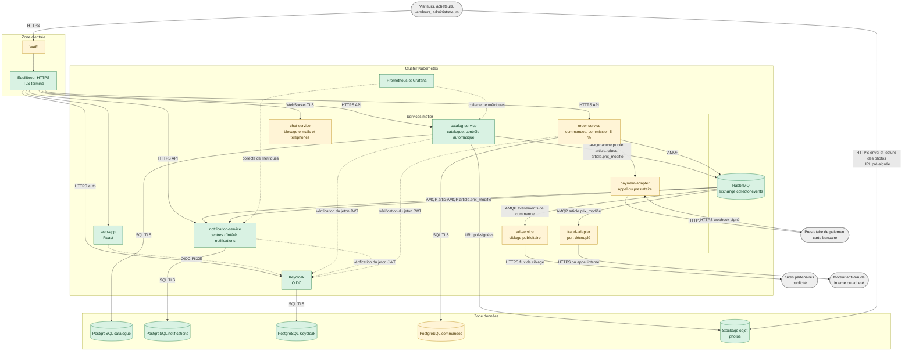
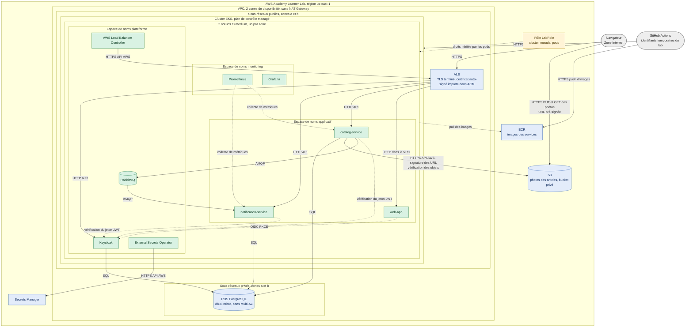

# Architecture technique

Carte S1-09. Critère visé : **C2** (découpage, communication interservices, sécurité, hébergement et orchestration validés et documentés).

Deux vues :

1. l'**architecture cible** complète de Collector.shop (tous les services du contexte) ;
2. le **périmètre du POC** sur AWS Academy Learner Lab, région **us-east-1**.

Le POC n'implémente qu'une partie de la cible : catalogue, notification, identité, messagerie, observabilité. Les autres services sont des **extensions branchées sur le même bus d'événements** (exchange topic `collector.events`), ce qui permet de les ajouter sans modifier les services existants.

## 1. Architecture cible

Légende : vert = réalisé dans le POC ; jaune = cible, hors POC ; gris = systèmes externes.

Principes de la cible :

- **Une base par service** : aucun service ne lit la base d'un autre ; les échanges passent par l'API ou par un événement.
- **Communication asynchrone par événements** pour les effets de bord (notification, anti-fraude, publicité), avec des contrats versionnés dans `packages/contracts`. Les appels synchrones sont réservés aux requêtes de l'utilisateur.
- **Anti-fraude derrière un port** : `fraud-adapter` isole le choix « interne ou acheté » ; changer de solution ne touche que cet adaptateur.
- **Paiement par un prestataire** : les données de carte ne transitent jamais par Collector.shop, la plateforme ne manipule que des références de transaction et reçoit des confirmations signées par webhook.
- **Évolutivité** : enchères, vente en direct et robot conversationnel s'ajoutent comme de nouveaux services abonnés au bus.

## 2. Périmètre du POC sur le Learner Lab (us-east-1)

Faute de **nom de domaine** dans le POC (décision du 20/11/2026), le certificat de l'ALB est un **certificat auto-signé** généré par Terraform et importé dans ACM : le trafic est chiffré, mais le navigateur affiche un avertissement. Un domaine avec un certificat ACM validé par DNS reste la cible ; si le HTTPS auto-signé échoue en bac à sable (S2-02), le repli est le HTTP sur le nom DNS de l'ALB, avec les limites décrites dans [ADR-0003](../adr/0003-ingress-alb.md).

Les **photos** des articles sont envoyées directement par le navigateur dans un bucket S3 privé, avec des URL pré-signées délivrées par `catalog-service` ([ADR-0005](../adr/0005-stockage-photos-s3.md)) : elles ne transitent ni par l'ALB ni par les pods.

### Dimensionnement et contraintes appliquées

| Élément | Valeur dans le POC | Raison |
|---|---|---|
| Région | us-east-1 | Seules us-east-1 et us-west-2 sont autorisées par le lab |
| Zones de disponibilité | 2 | Exigence de l'ALB (2 sous-réseaux publics) et du groupe de sous-réseaux RDS |
| Nœuds | 2 × `t3.medium`, sous-réseaux publics | Budget : pas de NAT Gateway ; sortie Internet directe |
| Base de données | RDS PostgreSQL `db.t3.micro`, sous-réseaux privés, sans Multi-AZ | Budget et limite du lab (RDS jusqu'à la taille medium) |
| Identité AWS | `LabRole` pour le cluster, le groupe de nœuds et, par héritage, les pods | Création de rôles IAM et de fournisseurs OIDC interdite |
| Accès CI → AWS | Identifiants temporaires du lab dans les secrets GitHub | OIDC GitHub → IAM impossible |
| Cycle de vie | Infrastructure créée en début de session, détruite en fin, sauf un socle conservé (bucket du state Terraform, dépôts ECR, bucket des photos) | Sessions d'environ 4 h, budget limité ; le socle coûte quelques centimes de stockage |

## 3. Protocoles et zones de sécurité

### Zones

| Zone | Contenu | Confiance | Contrôles d'accès (POC) | Cible production |
|---|---|---|---|---|
| Z0 Internet | Navigateurs, sites partenaires, prestataire de paiement | Aucune | HTTPS seul exposé | WAF, limitation de débit |
| Z1 Entrée | ALB, certificat auto-signé importé dans ACM | Faible | Ports 80 (redirection) et 443 uniquement ; TLS terminé ici | Domaine et certificat ACM de confiance, journaux d'accès, WAF |
| Z2 Applicative | Nœuds EKS, pods applicatifs et plateforme | Moyenne | Groupes de sécurité (ALB et plan de contrôle seuls entrants), PSS, NetworkPolicies à valider | Nœuds en sous-réseaux **privés**, NAT Gateway ou points de terminaison VPC, mTLS interne |
| Z3 Données | RDS PostgreSQL | Élevée | Sous-réseaux privés, groupe de sécurité limité aux nœuds, chiffrement au repos | Multi-AZ, clé de chiffrement gérée par le client, sauvegardes testées |
| Z4 Services AWS gérés | ECR, Secrets Manager, S3 (photos) | Élevée | Appels API authentifiés avec les droits de `LabRole` ; bucket des photos privé (accès public bloqué, chiffrement SSE-S3), accès des navigateurs uniquement par URL pré-signée de courte durée | Un rôle IAM par service (Pod Identity ou IRSA), points de terminaison VPC, analyse antivirus des photos |
| Z5 Chaîne de livraison | GitHub, GitHub Actions | Moyenne | Secrets d'*environment*, identifiants temporaires | OIDC GitHub → IAM |

### Flux

| Flux | Protocole | Authentification | Chiffrement |
|---|---|---|---|
| Navigateur → ALB | HTTPS (TLS 1.2 ou plus) | Jeton d'accès dans l'en-tête `Authorization` pour les API | TLS, certificat auto-signé dans le POC ; certificat ACM de confiance en cible |
| Navigateur → S3 | HTTPS, URL pré-signée (`PUT` pour l'envoi, `GET` pour l'affichage) | Signature de l'URL, valable quelques minutes, limitée à un objet, un type de contenu et une taille | TLS ; SSE-S3 au repos |
| ALB → pods | HTTP dans le VPC | Aucune (réseau de confiance, restreint par groupes de sécurité) | Non chiffré dans le POC ; TLS interne en cible |
| Navigateur ↔ Keycloak | OIDC (Authorization Code avec PKCE) via HTTPS | Identifiants utilisateur | TLS |
| Service → Keycloak | HTTPS (clés publiques JWKS) | Aucune (clés publiques) | TLS |
| catalog-service → S3 | HTTPS (API AWS signée) | Droits de `LabRole` | TLS |
| catalog-service → RabbitMQ → notification-service | AMQP | Utilisateur dédié par service | Canal interne au cluster ; TLS AMQP en cible |
| Services → PostgreSQL | SQL (protocole PostgreSQL) | Utilisateur de base par service, mot de passe dans Secrets Manager | TLS avec RDS |
| External Secrets Operator → Secrets Manager | HTTPS (API AWS signée) | Droits de `LabRole` | TLS |
| Prometheus → services | HTTP, endpoint `/metrics` | Réseau interne | Non chiffré dans le POC |
| GitHub Actions → ECR, EKS | HTTPS (API AWS, API Kubernetes) | Identifiants temporaires du lab | TLS |

## 4. Choix techniques et justification

| Domaine | Choix | Justification | Alternatives écartées | ADR |
|---|---|---|---|---|
| Organisation du code | Monorepo avec workspaces npm | Une seule personne, contrats d'événements partagés sans publication de paquet, un pipeline unique | Dépôt par service, Nx / Turborepo | [ADR-0001](../adr/0001-monorepo.md) |
| Hébergement | AWS (EKS, ECR, RDS, Secrets Manager) | Environnement managé exigé (C5) ; Azure indisponible faute d'abonnement | Azure payant, Kubernetes local, ECS / Fargate | [ADR-0002](../adr/0002-aws-au-lieu-d-azure.md) |
| Contexte AWS | Learner Lab, us-east-1, `LabRole` | Seul compte fourni par l'école ; contraintes IAM et budget documentées | Compte AWS personnel, Kubernetes local | [ADR-0004](../adr/0004-learner-lab.md) |
| Entrée HTTPS | AWS Load Balancer Controller + ACM ; certificat auto-signé importé tant qu'il n'y a pas de domaine | ingress-nginx est en fin de vie depuis mars 2026 ; une seule ALB partagée par les Ingress | ingress-nginx | [ADR-0003](../adr/0003-ingress-alb.md) |
| Photos des articles | S3 privé, envoi direct par URL pré-signée | Pas de fichier lourd dans les pods ni dans la base ; stockage durable et peu coûteux | URL externe, stockage en base, volume Kubernetes | [ADR-0005](../adr/0005-stockage-photos-s3.md) |
| Orchestration | Kubernetes managé (EKS) | Portabilité entre clouds, montée en charge démontrable, correspond à la cible | ECS / Fargate | [ADR-0002](../adr/0002-aws-au-lieu-d-azure.md) |
| Back-end | NestJS (Node.js 24, TypeScript) | Structure modulaire imposée, injection de dépendances, gardes d'autorisation, même langage que le front et les contrats | Express nu, Spring Boot | Pas d'ADR : décision actée au cadrage |
| Front-end | React + TypeScript (Vite), react-i18next | Écosystème mature, i18n exigée (EF-16), types partagés | Autres frameworks | Pas d'ADR : décision actée au cadrage |
| Messagerie | RabbitMQ, exchange topic `collector.events` | Routage par clé (`article.publie`...), découplage producteur / consommateur, simple à opérer pour le volume du POC | Appels HTTP synchrones, Kafka (plus lourd à opérer) | Pas d'ADR : décision actée au cadrage |
| Contrats d'événements | Types TypeScript versionnés (`packages/contracts`), champ `eventId` pour l'idempotence | Producteur et consommateur compilés contre les mêmes types | Schéma documenté sans code partagé | Voir `packages/contracts/README.md` |
| Données | PostgreSQL (RDS), une base par service | Relationnel adapté au catalogue et aux commandes ; isolation des services | Base partagée, NoSQL | Pas d'ADR : décision actée au cadrage |
| Identité | Keycloak (OIDC, rôles acheteur / vendeur / admin) | Standard ouvert, pas de développement d'authentification maison, fédération possible avec l'annuaire d'entreprise | Authentification maison, service géré | Pas d'ADR : décision actée au cadrage |
| Infrastructure as Code | Terraform (état dans S3), Helm | Reproductibilité (détruire / recréer à chaque session), versions reproductibles | Console AWS, eksctl | Contraintes du lab dans ADR-0004 |
| CI/CD | GitHub Actions, SonarCloud, Trivy, gitleaks, CodeQL, Dependabot, OWASP ZAP | Intégration native au dépôt, couverture SAST / SCA / secrets / images / DAST | Jenkins auto-hébergé | [ci-cd.md](../process/ci-cd.md) |
| Observabilité | Prometheus + Grafana, `/metrics` | Standard Kubernetes, alimente l'indicateur IQ4 | CloudWatch seul | [indicateurs-qualite.md](../process/indicateurs-qualite.md) |
| Tests | Jest, Supertest, Testcontainers, k6, Playwright (bonus) | Voir la politique de tests | | [politique-de-tests.md](../process/politique-de-tests.md) |

Les décisions marquées « Pas d'ADR » ont été prises au cadrage du projet ; les consigner dans des ADR dédiés est possible si le jury demande leur trace.

## 5. Flux de la fonctionnalité POC

1. Le vendeur s'authentifie auprès de Keycloak (OIDC avec PKCE) et reçoit un jeton portant le rôle vendeur.
2. Il demande à `catalog-service` une URL pré-signée par photo, puis envoie chaque fichier directement dans S3.
3. Il soumet l'article à `catalog-service`, qui vérifie le jeton et le rôle (401 ou 403 sinon).
4. Le contrôle automatique accepte l'article, le refuse avec un ou plusieurs motifs enregistrés, ou le place en revue manuelle si son prix dépasse 10 fois la médiane de sa catégorie.
5. Si l'article est accepté, `catalog-service` publie `article.publie` sur `collector.events` ; s'il est refusé, il publie `article.refuse`.
6. `notification-service` consomme `article.publie`, ignore les événements déjà traités (`eventId`) et crée une notification pour chaque acheteur dont un centre d'intérêt correspond à la catégorie.

Le détail des scénarios est dans [user-stories.md](../backlog/user-stories.md).

## 6. Écarts entre le POC et la cible

Les écarts de sécurité et de disponibilité sont suivis dans [devsecops.md](../process/devsecops.md) (section 5) et traités dans le [plan de remédiation](../remediation/README.md).

| Sujet | POC (Learner Lab) | Cible sur un vrai compte AWS |
|---|---|---|
| Identité des pods | Droits hérités de `LabRole` | Un rôle IAM par service (Pod Identity ou IRSA) |
| Accès CI → AWS | Identifiants temporaires dans GitHub | OIDC GitHub → IAM |
| Réseau | Nœuds en sous-réseaux publics, pas de NAT Gateway | Nœuds privés, NAT Gateway ou points de terminaison VPC |
| Disponibilité | 2 zones pour les nœuds, RDS sans Multi-AZ | RDS Multi-AZ, plus de nœuds répartis |
| Trafic interne | HTTP et AMQP non chiffrés dans le cluster | mTLS, TLS AMQP |
| Certificat | Auto-signé, pas de nom de domaine | Domaine maîtrisé, certificat ACM validé par DNS |
| Photos | Contrôle du type déclaré et de la taille | Analyse antivirus, vérification du contenu réel, suppression des métadonnées EXIF |
| Périmètre fonctionnel | Catalogue, contrôle, notification | Commandes, paiement, chat, anti-fraude, publicité |

## 7. Questions ouvertes

Tranchées le 20/11/2026 : pas de nom de domaine dans le POC (certificat auto-signé, voir [ADR-0003](../adr/0003-ingress-alb.md)) et photos dans S3 ([ADR-0005](../adr/0005-stockage-photos-s3.md)). Restent ouvertes :

- **Persistance de RabbitMQ** : volume persistant ou données éphémères dans le POC (l'infrastructure est détruite à chaque session) ; à vérifier en bac à sable.
- **NetworkPolicies** : prise en charge par le VPC CNI à activer et tester dans le lab.
