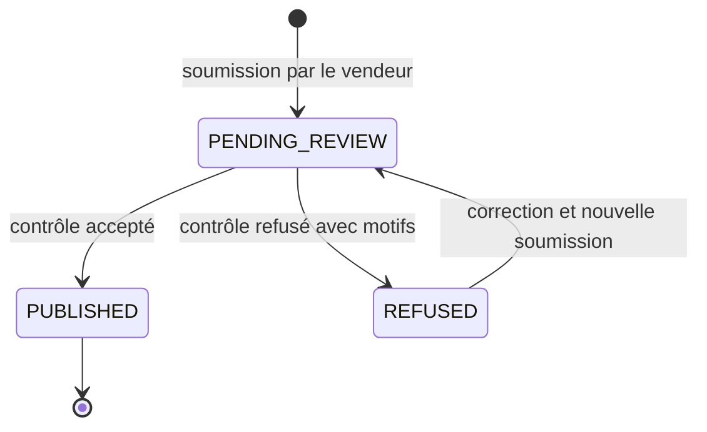
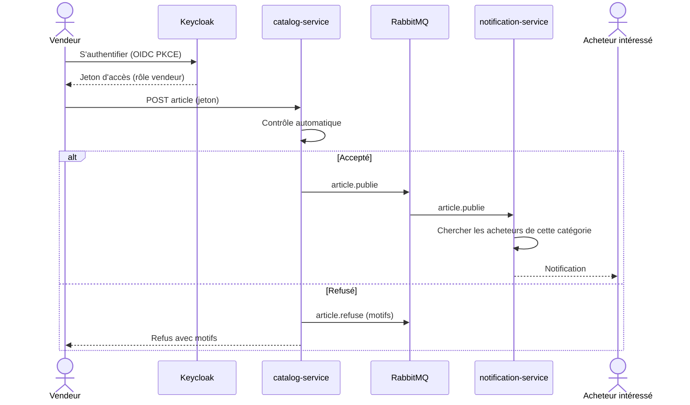

# Exigences et user stories du POC

Carte S1-08. Critère visé : **C3** (la fonctionnalité répond au besoin de la maîtrise d'ouvrage).

Fonctionnalité métier du POC (validée) : un vendeur publie un article ; un contrôle automatique l'accepte ou le refuse avec un motif ; l'événement `article.publie` déclenche une notification aux acheteurs dont un centre d'intérêt correspond.

## 1. Exigences fonctionnelles reformulées

Source : contexte métier de Collector.shop. **Hypothèse à confirmer avec le cahier des charges** : V1 = nécessaire au lancement de la place de marché ; V2 = évolution ultérieure. La colonne « POC » indique ce qui est réalisé dans le périmètre de l'évaluation.

| Réf. | Exigence reformulée | Version | POC | Stories |
|---|---|---|---|---|
| EF-01 | Un visiteur consulte le catalogue des articles en vente sans créer de compte. | V1 | Oui | US-05 |
| EF-02 | Un utilisateur s'authentifie avec un rôle : acheteur, vendeur ou administrateur. | V1 | Oui (vendeur et acheteur) | US-01, US-08 |
| EF-03 | Les accès aux fonctions sont contrôlés par rôle : l'absence d'identité est refusée (401), un rôle insuffisant est refusé (403). | V1 | Oui | US-08 |
| EF-04 | Un vendeur particulier peut gérer plusieurs boutiques. | V1 | Non : le modèle de données porte déjà `shopId` ; une boutique par défaut suffit au POC | |
| EF-05 | Un vendeur publie un article avec photos, description précise, prix et frais de port. | V1 | Oui | US-02 |
| EF-06 | Un article n'est mis en vente qu'après un contrôle automatisé autant que possible. | V1 | Oui | US-03 |
| EF-07 | Un article refusé par le contrôle l'est avec un motif lisible par le vendeur. | V1 | Oui | US-04 |
| EF-08 | Un acheteur déclare ses centres d'intérêt (catégories). | V1 | Oui | US-06 |
| EF-09 | Les acheteurs dont un centre d'intérêt correspond sont notifiés à la publication d'un article. | V1 | Oui | US-07 |
| EF-10 | L'administrateur gère les catégories, modère et supprime articles ou vendeurs. | V1 | Non | |
| EF-11 | Toute variation de prix est historisée. | V1 | Non (événement `article.prix_modifie` défini dans `packages/contracts`) | |
| EF-12 | Une variation de prix est notifiée aux acheteurs intéressés. | V1 | Non | |
| EF-13 | Une variation de prix est transmise à un composant anti-fraude, interne ou acheté, intégré de façon découplée. | V1 | Non | |
| EF-14 | Le paiement se fait par carte uniquement, via la plateforme, avec une commission de 5 % par transaction. | V1 | Non | |
| EF-15 | Le chat entre acheteur et vendeur bloque l'échange d'adresses e-mail et de numéros de téléphone. | V1 | Non (la même détection sert au contrôle des descriptions, US-04) | |
| EF-16 | La plateforme est disponible en plusieurs langues (i18n). | V1 | Oui, interface en français et en anglais | US-09 |
| EF-17 | L'interface respecte les règles d'accessibilité. | V1 | Oui, sur les écrans du POC | US-10 |
| EF-18 | Le vendeur voit le statut de ses articles et, en cas de refus, le motif. | V1 | Oui | US-04 |
| EF-19 | Les acheteurs reçoivent des recommandations selon leurs centres d'intérêt. | V2 | Non | |
| EF-20 | Des publicités ciblées sont diffusées sur des sites partenaires. | V2 | Non | |
| EF-21 | L'architecture permet d'ajouter enchères, ventes en direct et robot conversationnel. | V2 | Non (exigence d'architecture, voir [architecture](../architecture/README.md)) | |

## 2. Règles de gestion du contrôle automatique

Ces règles sont des **hypothèses de maîtrise d'ouvrage à valider** ; elles sont paramétrables dans le code.

| Code du motif | Condition de refus | Détail |
|---|---|---|
| `MISSING_PHOTO` | L'article n'a aucune photo | Au moins une photo est exigée |
| `CONTACT_INFO_IN_DESCRIPTION` | La description contient une adresse e-mail ou un numéro de téléphone | Détection par expressions régulières (formats e-mail ; numéros français et internationaux, avec ou sans séparateurs). Les contournements écrits en toutes lettres (« arobase », « zéro six… ») ne sont pas détectés dans le POC : limite documentée, traitée en V2 |
| `ABNORMAL_PRICE` | Le prix est inférieur ou égal à 0, ou supérieur à 100 000 € | Bornes configurables ; une détection relative à la catégorie est une évolution V2 |

Plusieurs motifs peuvent s'appliquer ensemble : l'événement `article.refuse` les liste tous dans `reasons`. Les centres d'intérêt correspondent aux **catégories** (`categoryId` de l'événement `article.publie`).

États d'un article :



Flux nominal de la fonctionnalité :



## 3. User stories

Priorités MoSCoW : **M** (Must : indispensable à la démonstration), **S** (Should), **C** (Could).

### US-01 : se connecter en tant que vendeur

**En tant que** vendeur, **je veux** m'authentifier avec mon compte, **afin de** publier des articles sous mon identité. Priorité : **M**. Exigences : EF-02.

```gherkin
Scénario: Connexion réussie d'un vendeur
  Étant donné un compte vendeur existant dans Keycloak
  Quand le vendeur s'authentifie avec ses identifiants via le flux OIDC avec PKCE
  Alors il obtient un jeton d'accès contenant le rôle "seller"
  Et l'interface affiche l'espace vendeur

Scénario: Identifiants invalides
  Étant donné un compte vendeur existant
  Quand le vendeur saisit un mot de passe incorrect
  Alors l'authentification échoue avec un message d'erreur générique
  Et aucun jeton n'est délivré

Scénario: Jeton expiré
  Étant donné un vendeur dont le jeton d'accès est expiré
  Quand il appelle l'API de publication
  Alors l'API répond 401
```

### US-02 : publier un article

**En tant que** vendeur, **je veux** soumettre un article avec photos, description, prix et frais de port, **afin de** le mettre en vente. Priorité : **M**. Exigences : EF-05, EF-06.

```gherkin
Scénario: Soumission d'un article complet
  Étant donné un vendeur authentifié
  Quand il soumet un article avec un titre, une catégorie, une description, une photo, un prix et des frais de port
  Alors l'API répond 201
  Et l'article est enregistré au statut "PENDING_REVIEW" avec l'identifiant du vendeur

Scénario: Champs obligatoires manquants
  Étant donné un vendeur authentifié
  Quand il soumet un article sans titre ni catégorie
  Alors l'API répond 400
  Et la réponse liste les champs invalides
  Et aucun article n'est enregistré

Scénario: Prix ou frais de port négatif
  Étant donné un vendeur authentifié
  Quand il soumet un article avec des frais de port négatifs
  Alors l'API répond 400
```

### US-03 : le contrôle automatique accepte l'article

**En tant que** vendeur, **je veux** que mon article conforme soit mis en vente sans intervention manuelle, **afin de** le vendre rapidement. Priorité : **M**. Exigences : EF-06.

```gherkin
Scénario: Article conforme accepté
  Étant donné un article soumis avec au moins une photo, une description sans coordonnées et un prix de 45 €
  Quand le contrôle automatique s'exécute
  Alors l'article passe au statut "PUBLISHED"
  Et un événement "article.publie" est publié sur l'exchange "collector.events"
  Et l'événement contient l'identifiant de l'article, du vendeur, de la boutique, la catégorie, le titre et le prix en centimes

Scénario: Un échec de publication de l'événement n'est pas perdu
  Étant donné un article accepté
  Quand RabbitMQ est indisponible au moment de la publication de l'événement
  Alors l'événement est conservé pour une nouvelle tentative
  Et l'article reste au statut "PUBLISHED"
```

### US-04 : le contrôle automatique refuse l'article avec un motif

**En tant que** vendeur, **je veux** connaître la raison du refus de mon article, **afin de** le corriger et de le soumettre à nouveau. Priorité : **M**. Exigences : EF-06, EF-07, EF-15, EF-18.

```gherkin
Scénario: Photo manquante
  Étant donné un article soumis sans aucune photo
  Quand le contrôle automatique s'exécute
  Alors l'article passe au statut "REFUSED" avec le motif "MISSING_PHOTO"
  Et un événement "article.refuse" contenant ce motif est publié
  Et le vendeur voit le motif en consultant l'article

Scénario: Adresse e-mail dans la description
  Étant donné un article dont la description contient "contactez-moi sur jean.dupont@example.com"
  Quand le contrôle automatique s'exécute
  Alors l'article est refusé avec le motif "CONTACT_INFO_IN_DESCRIPTION"

Scénario: Numéro de téléphone dans la description
  Étant donné un article dont la description contient "appelez le 06 12 34 56 78"
  Quand le contrôle automatique s'exécute
  Alors l'article est refusé avec le motif "CONTACT_INFO_IN_DESCRIPTION"

Scénario: Prix anormal
  Étant donné un article au prix de 0 €
  Quand le contrôle automatique s'exécute
  Alors l'article est refusé avec le motif "ABNORMAL_PRICE"

Scénario: Plusieurs motifs cumulés
  Étant donné un article sans photo et au prix de 0 €
  Quand le contrôle automatique s'exécute
  Alors l'événement "article.refuse" contient les motifs "MISSING_PHOTO" et "ABNORMAL_PRICE"

Scénario: Aucune notification pour un article refusé
  Étant donné un article refusé par le contrôle automatique
  Alors aucun événement "article.publie" n'est émis
  Et aucun acheteur ne reçoit de notification

Scénario: Resoumission après correction
  Étant donné un article refusé pour "MISSING_PHOTO"
  Quand le vendeur ajoute une photo et soumet à nouveau l'article
  Alors l'article repasse par le contrôle automatique
```

### US-05 : consulter le catalogue sans compte

**En tant que** visiteur, **je veux** parcourir les articles en vente sans m'inscrire, **afin de** découvrir la plateforme. Priorité : **M**. Exigences : EF-01.

```gherkin
Scénario: Liste publique des articles publiés
  Étant donné trois articles publiés et deux articles refusés
  Quand un visiteur sans jeton demande la liste du catalogue
  Alors l'API répond 200
  Et la réponse contient exactement les trois articles publiés
  Et elle ne contient aucune donnée personnelle du vendeur

Scénario: Filtrer par catégorie
  Étant donné des articles publiés dans les catégories "Monnaies" et "Cartes"
  Quand un visiteur filtre sur la catégorie "Cartes"
  Alors seuls les articles de la catégorie "Cartes" sont retournés

Scénario: Catalogue vide
  Étant donné qu'aucun article n'est publié
  Quand un visiteur demande la liste du catalogue
  Alors l'API répond 200 avec une liste vide

Scénario: Détail d'un article non publié
  Étant donné un article au statut "REFUSED"
  Quand un visiteur demande son détail
  Alors l'API répond 404
```

### US-06 : paramétrer ses centres d'intérêt

**En tant qu'** acheteur, **je veux** choisir les catégories qui m'intéressent, **afin d'** être prévenu des nouveaux articles correspondants. Priorité : **M**. Exigences : EF-08.

```gherkin
Scénario: Enregistrer ses centres d'intérêt
  Étant donné un acheteur authentifié
  Quand il sélectionne les catégories "Monnaies" et "Cartes"
  Alors l'API répond 200
  Et la relecture de ses préférences retourne ces deux catégories

Scénario: Catégorie inexistante
  Étant donné un acheteur authentifié
  Quand il sélectionne une catégorie qui n'existe pas
  Alors l'API répond 400

Scénario: Modifier ses centres d'intérêt
  Étant donné un acheteur intéressé par "Monnaies"
  Quand il remplace sa sélection par "Cartes"
  Alors il n'est plus notifié pour la catégorie "Monnaies"

Scénario: Préférences d'un autre acheteur
  Étant donné deux acheteurs authentifiés
  Quand le premier tente de lire les préférences du second
  Alors l'API répond 403
```

### US-07 : recevoir une notification à la publication d'un article correspondant

**En tant qu'** acheteur, **je veux** être notifié quand un article de ma catégorie est publié, **afin de** ne pas le manquer. Priorité : **M**. Exigences : EF-09.

```gherkin
Scénario: Notification d'un acheteur intéressé
  Étant donné un acheteur intéressé par la catégorie "Cartes"
  Quand un événement "article.publie" de la catégorie "Cartes" est reçu
  Alors une notification est créée pour cet acheteur
  Et elle référence l'article, son titre et son prix

Scénario: Aucun acheteur intéressé
  Étant donné aucun acheteur intéressé par la catégorie "Monnaies"
  Quand un événement "article.publie" de la catégorie "Monnaies" est reçu
  Alors aucune notification n'est créée
  Et l'événement est acquitté

Scénario: Acheteur intéressé par une autre catégorie
  Étant donné un acheteur intéressé uniquement par "Monnaies"
  Quand un événement "article.publie" de la catégorie "Cartes" est reçu
  Alors cet acheteur ne reçoit aucune notification

Scénario: Livraison en double du même événement
  Étant donné un événement "article.publie" déjà traité
  Quand le même événement (même "eventId") est reçu une seconde fois
  Alors aucune notification supplémentaire n'est créée

Scénario: Consultation de ses notifications
  Étant donné un acheteur notifié
  Quand il consulte ses notifications
  Alors il voit la notification, la plus récente en premier
  Et il ne voit jamais les notifications d'un autre acheteur

Scénario: Événement invalide
  Étant donné un message dont le contenu ne respecte pas le contrat "article.publie"
  Quand il est reçu par le service de notification
  Alors il est rejeté vers une file d'événements en échec
  Et aucune notification n'est créée
```

### US-08 : accès refusé en 401 ou 403 selon le rôle

**En tant que** responsable de la plateforme, **je veux** que chaque fonction soit réservée au bon rôle, **afin de** protéger les données et les actions sensibles. Priorité : **M**. Exigences : EF-02, EF-03.

```gherkin
Plan du Scénario: Matrice d'accès par rôle
  Étant donné un appelant avec le profil <profil>
  Quand il appelle <endpoint>
  Alors l'API répond <statut>

  Exemples:
    | profil                  | endpoint                              | statut |
    | aucun jeton             | POST /articles                        | 401    |
    | jeton expiré            | POST /articles                        | 401    |
    | jeton à signature falsifiée | POST /articles                    | 401    |
    | acheteur                | POST /articles                        | 403    |
    | vendeur                 | POST /articles                        | 201    |
    | aucun jeton             | GET /articles                         | 200    |
    | vendeur                 | PUT /buyers/me/interests              | 403    |
    | acheteur                | PUT /buyers/me/interests              | 200    |
    | aucun jeton             | GET /notifications                    | 401    |
    | vendeur                 | DELETE /admin/articles/{id}           | 403    |

Scénario: Un vendeur ne modifie pas l'article d'un autre vendeur
  Étant donné deux vendeurs authentifiés
  Quand le vendeur B tente de modifier un article du vendeur A
  Alors l'API répond 403

Scénario: Réponses d'erreur sans fuite d'information
  Étant donné un appel refusé en 401 ou 403
  Alors la réponse ne contient ni trace d'appels ni détail technique
```

Les points d'entrée ci-dessus sont des noms de travail ; ils seront figés dans la spécification OpenAPI des services.

### US-09 : utiliser l'interface en français ou en anglais

**En tant qu'** utilisateur, **je veux** choisir ma langue, **afin de** comprendre l'interface. Priorité : **S**. Exigences : EF-16.

```gherkin
Scénario: Changement de langue
  Étant donné un utilisateur sur la page du catalogue en français
  Quand il choisit l'anglais
  Alors tous les libellés de l'interface s'affichent en anglais
  Et son choix est conservé à la visite suivante

Scénario: Motif de refus traduit
  Étant donné un article refusé avec le motif "MISSING_PHOTO"
  Quand le vendeur consulte l'article en anglais
  Alors le motif s'affiche en anglais
```

### US-10 : utiliser les écrans du POC au clavier

**En tant qu'** utilisateur de technologies d'assistance, **je veux** parcourir les écrans du POC au clavier avec des libellés explicites, **afin de** publier et consulter sans souris. Priorité : **C**. Exigences : EF-17.

```gherkin
Scénario: Formulaire de publication accessible
  Étant donné le formulaire de publication d'un article
  Quand l'utilisateur navigue uniquement au clavier
  Alors chaque champ est atteignable dans un ordre logique
  Et chaque champ a un libellé associé
  Et les erreurs de validation sont annoncées avec le champ concerné

Scénario: Contrôle automatisé d'accessibilité
  Étant donné les pages catalogue et publication
  Quand l'outil d'audit d'accessibilité s'exécute
  Alors il ne signale aucune violation de niveau critique
```

## 4. Stories techniques (nécessaires au POC)

Ce ne sont pas des fonctions métier, mais elles conditionnent des critères de la grille (C2, C5, C8).

| Réf. | Énoncé | Priorité | Critère d'acceptation | Critère de grille |
|---|---|---|---|---|
| ST-01 | En tant que lead dev, je veux que chaque service expose `/metrics`, afin d'observer le taux d'erreur et la latence. | M | `GET /metrics` retourne les métriques Prometheus, dont un histogramme de durée des requêtes HTTP ; Grafana les affiche | C2, C5 |
| ST-02 | En tant que lead dev, je veux que l'application soit servie en HTTPS, afin de protéger les échanges et les jetons. | M | Une requête HTTP est redirigée vers HTTPS ; le certificat est valide | C2, C8 |
| ST-03 | En tant que lead dev, je veux une sonde de santé par service, afin que Kubernetes détecte les pannes. | M | `GET /health` répond 200 si le service et ses dépendances sont prêts, sinon 503 | C5 |

## 5. Traçabilité

| Exigence | Story | Test d'acceptation (voir [politique de tests](../process/politique-de-tests.md)) |
|---|---|---|
| EF-01 | US-05 | `us-05-catalogue-public.acceptance.spec.ts` |
| EF-02, EF-03 | US-01, US-08 | `us-01-connexion-vendeur.acceptance.spec.ts`, `us-08-acces-par-role.acceptance.spec.ts` |
| EF-05, EF-06 | US-02, US-03 | `us-02-publier-article.acceptance.spec.ts`, `us-03-controle-accepte.acceptance.spec.ts` |
| EF-07, EF-15, EF-18 | US-04 | `us-04-controle-refuse.acceptance.spec.ts` |
| EF-08 | US-06 | `us-06-centres-interet.acceptance.spec.ts` |
| EF-09 | US-07 | `us-07-notification.acceptance.spec.ts` |
| EF-16 | US-09 | Test de composant React (i18n) |
| EF-17 | US-10 | Audit d'accessibilité automatisé (bonus) |

## 6. Décisions à valider

- Signification de V1 et V2 (voir l'hypothèse en section 1).
- Bornes de prix anormal (0 € et 100 000 €) et liste des motifs de refus.
- Format des notifications dans le POC : création d'une notification consultable dans l'application ; l'envoi par e-mail est exclu du POC.
- Stockage des photos : le POC exige qu'au moins une photo soit jointe, mais le mécanisme (stockage objet, par exemple S3, ou simple référence d'image) reste à trancher ; il influence US-02 et le schéma d'architecture.
