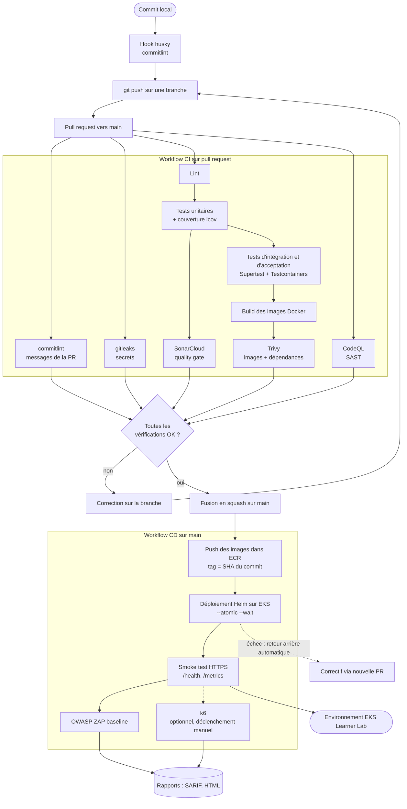

# Pipeline CI/CD

Carte S1-05. Critère visé : **C4** (processus CI/CD schématisé, conforme, implémenté dans le POC).

Outil : GitHub Actions. Les indicateurs IQ1 à IQ4 sont définis dans [indicateurs-qualite.md](indicateurs-qualite.md), les mesures de sécurité dans [devsecops.md](devsecops.md).

## 1. Vue d'ensemble : du commit à l'environnement déployé

Deux chemins de décision coexistent :

- **avant la fusion**, tout contrôle rouge empêche la fusion (protection de la branche `main`) ;
- **après la fusion**, un échec de déploiement déclenche le retour arrière Helm ; un échec du smoke test ou de ZAP signale une version à corriger par une nouvelle PR (pas de commit direct sur `main`).

## 2. Déclencheurs

| Événement | Workflow | Contenu |
|---|---|---|
| `pull_request` | `ci.yml` | Étapes de la section 3.1 |
| `push` sur `main` | `ci.yml` puis `cd.yml` (à créer) | Contrôles de la PR rejoués, puis étapes de la section 3.2 |
| `schedule` hebdomadaire | `codeql.yml` (à créer) | Analyse CodeQL, indépendante des PR |
| `workflow_dispatch` | `cd.yml` | Déploiement manuel et test de charge k6 à la demande |
| Dependabot | `dependabot.yml` | PR de mise à jour (npm, GitHub Actions, Docker, Terraform) passant par le même pipeline |

## 3. Étapes détaillées

Les colonnes « Bloque » indiquent ce qui fait échouer l'étape et donc empêche la progression. La colonne « Indicateurs » renvoie aux fiches IQ1 à IQ4.

### 3.1 Sur pull request

| # | Étape | Déclencheur | Ce qui bloque | Indicateurs alimentés | État |
|---|---|---|---|---|---|
| 1 | **commitlint** (hook husky en local, job CI sur la plage de commits de la PR) | Commit, PR | Message hors Conventional Commits ou scope non autorisé | Hygiène de l'historique (IQ2, indirect) | **En place** (job `commitlint`). Il n'est pas dans les vérifications requises de `main` (voir 5) |
| 2 | **gitleaks** | PR, push sur `main` | Tout secret détecté dans les commits | IQ3 | **En place** (job `secrets-scan`, vérification requise) |
| 3 | **Lint** (`npm run lint`) | PR | Erreur de lint | IQ2 | **En place** pour le câblage ; les workspaces n'ont pas encore de script `lint`, l'étape ne vérifie donc rien avant S2-07 |
| 4 | **Tests unitaires** avec couverture (`npm test`, Jest `--coverage`) | PR | Un test échoue | IQ1 | **En place** pour le câblage, sans test avant S2-07 ; la couverture reste **à faire** |
| 5 | **SonarCloud**, quality gate | PR | Couverture du nouveau code < 80 %, note de maintenabilité < A, duplication > 3 %, point sensible non revu | IQ1, IQ2, IQ3 (SAST) | **À faire** (S2-08) |
| 6 | **CodeQL** | PR, hebdomadaire | Alerte de sévérité haute ou critique | IQ3 | **À faire** (S2-08) |
| 7 | **Tests d'intégration et d'acceptation** (`npm run test:integration`, Supertest + Testcontainers : PostgreSQL et RabbitMQ éphémères) | PR | Un test échoue | Preuve de non-régression (critère C7) | **À faire** : le script racine existe, aucun test avant S3 |
| 8 | **Build des images** Docker (un `Dockerfile` par service, multi-étapes, utilisateur non root) | PR | Échec de build | IQ3 (surface de l'image) | **À faire** (S2-07 / S2-08) |
| 9 | **Trivy** : images et dépendances (`--severity CRITICAL,HIGH --ignore-unfixed --exit-code 1`) ; configuration Terraform et Helm (`trivy config`) | PR | CRITICAL ou HIGH avec correctif disponible | IQ3 | **À faire** (S2-08) |
| 10 | **Build du front et des services** (`npm run build`) | PR | Erreur de compilation TypeScript | IQ2 | **En place** pour le câblage, comme les étapes 3 et 4 |

Les étapes 3 à 10 s'exécutent dans des jobs parallèles quand elles sont indépendantes, avec la mise en cache des dépendances npm. Quand le monorepo comptera plus de composants, des filtres de chemins limiteront les jobs aux composants modifiés ([ADR-0001](../adr/0001-monorepo.md)).

### 3.2 Sur fusion dans `main`

| # | Étape | Déclencheur | Ce qui bloque | Indicateurs alimentés | État |
|---|---|---|---|---|---|
| 11 | **Push des images dans ECR** (tag = SHA du commit) | Fusion | Échec d'authentification AWS (identifiants du lab expirés), échec de poussée | | **À faire** (S2-08) |
| 12 | **Déploiement Helm sur EKS** (`helm upgrade --install --atomic --wait`, valeurs par environnement) | Après l'étape 11 | Pods non prêts dans le délai (sondes), retour arrière automatique | IQ4 (disponibilité) | **À faire** (S3-07 pour les charts, S2-08 pour le job) |
| 13 | **Smoke test** : requêtes HTTPS sur `/health` de chaque service et sur le catalogue public, vérification du certificat | Après l'étape 12 | Statut ≠ 200, certificat invalide | IQ4 | **À faire** (S2-08) |
| 14 | **OWASP ZAP baseline** sur l'URL déployée | Après l'étape 13 | Alerte de niveau élevé non justifiée | IQ3 (DAST) | **À faire** (S2-08 / S3) |
| 15 | **k6** : scénario de charge versionné dans `tests/load/` | Manuel (`workflow_dispatch`) et démonstration | `thresholds` dépassés (p95 > 800 ms ou erreurs ≥ 1 %) | IQ4 | **À faire** (S4-01), optionnel en CI |

### 3.3 Hors pipeline : l'infrastructure

Terraform n'est pas lancé automatiquement. Dans le Learner Lab, l'infrastructure est créée au début de chaque session et détruite à la fin ([ADR-0004](../adr/0004-learner-lab.md)). `terraform plan` peut s'exécuter en PR (lecture seule) ; **`apply` et `destroy` restent des actions manuelles** décidées par l'utilisateur. Le job de déploiement vérifie d'abord que le cluster existe (`aws eks describe-cluster`) et se termine proprement avec un message explicite sinon, pour qu'une session sans infrastructure ne fasse pas échouer la fusion.

## 4. Accès du pipeline à AWS

| | Dans le POC (Learner Lab) | Cible production |
|---|---|---|
| Mécanisme | Identifiants temporaires du lab (`AWS_ACCESS_KEY_ID`, `AWS_SECRET_ACCESS_KEY`, `AWS_SESSION_TOKEN`) dans les secrets GitHub | **OIDC GitHub → IAM** : aucun secret AWS stocké |
| Durée de vie | Environ 4 h, à **renouveler à chaque session** | Quelques minutes, par exécution |
| Périmètre | Droits de LabRole, secrets liés à un *environment* GitHub réservé à `main` | Rôle IAM dédié, politique de confiance restreinte au dépôt et à la branche, moindre privilège |
| Conséquence | Les jobs 11 à 13 échouent si les secrets n'ont pas été mis à jour : première vérification à faire en cas d'échec | Aucune opération manuelle |

Cet écart est traité dans le [plan de remédiation](../remediation/README.md).

## 5. État actuel et reste à faire

**Déjà en place** (`.github/workflows/ci.yml`, `.github/dependabot.yml`, `scripts/setup-branch-protection.sh`) :

- jobs `commitlint`, `secrets-scan` (gitleaks) et `lint-test-build` ;
- permissions limitées à `contents: read`, annulation des exécutions redondantes (`concurrency`) ;
- protection de `main` : PR obligatoire, historique linéaire, vérifications requises `lint-test-build` et `secrets-scan` ;
- Dependabot sur npm, GitHub Actions, Docker et Terraform.

**À corriger ou à faire :**

| Sujet | Détail | Carte |
|---|---|---|
| Le pipeline actuel ne vérifie encore rien d'applicatif | Les workspaces n'ont ni `lint`, ni `test`, ni `build` : les étapes passent « à vide » (`--if-present`) | S2-07 |
| `commitlint` n'est pas une vérification requise | Le script de protection ne liste que `lint-test-build` et `secrets-scan` ; ajouter `commitlint` à `contexts` | S2-08 |
| SonarCloud, CodeQL, Trivy | Jobs à ajouter, jeton `SONAR_TOKEN` dans les secrets GitHub | S2-08 |
| Tests d'intégration | Job Testcontainers (Docker est disponible sur `ubuntu-latest`) | S2-08, S3 |
| Build des images, ECR, déploiement Helm, smoke test, ZAP | Nouveau workflow `cd.yml` | S2-08, S3-07 |
| k6 | Scénario et job manuel | S4-01 |
| Mesure des indicateurs | Relevés de fin de sprint dans [indicateurs-qualite.md](indicateurs-qualite.md) | Chaque sprint |

## 6. Pourquoi ce découpage

- **Retour rapide d'abord** : les contrôles peu coûteux (messages, secrets, lint, tests unitaires) précèdent les contrôles lourds (intégration, images, scan), pour échouer tôt.
- **Un seul artefact promu** : l'image construite et scannée en PR est celle qui est déployée (tag = SHA), pas une reconstruction.
- **Sécurité décalée vers la gauche** : SAST, SCA, secrets et scan d'images bloquent avant la fusion ; le DAST ne peut s'exécuter qu'après déploiement, il est donc le dernier filet.
- **Déploiement réversible** : `--atomic` et les sondes évitent de laisser un déploiement à moitié appliqué.
