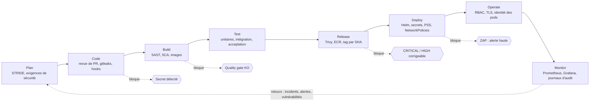

# Cycle de vie DevSecOps

Carte S1-04. Critères visés : **C4** (processus CI/CD) et **C8** (bonnes pratiques de sécurité, base du plan de remédiation).

## 1. Lecture du document

Le POC est hébergé sur **AWS Academy Learner Lab** (voir [ADR-0004](../adr/0004-learner-lab.md)). Ce compte interdit de créer des rôles IAM et des fournisseurs OIDC : plusieurs bonnes pratiques de production sont donc **impossibles dans le POC**. Chaque tableau distingue :

- **Dans le POC** : ce qui est mis en œuvre sur le Learner Lab, avec son état ;
- **Cible production** : ce qui serait fait sur un compte AWS complet.

Les écarts entre les deux colonnes ne sont pas des oublis : ils alimentent le [plan de remédiation](../remediation/README.md) (critère C8).

États utilisés : **En place** (vérifiable dans le dépôt), **Planifié** (carte ou sprint indiqué), **À valider** (dépend d'un essai en bac à sable ou de la disponibilité du service dans le lab), **Cible seule** (non réalisable dans le POC).

## 2. Cycle et contrôles de sécurité

## 3. Analyse des menaces (STRIDE)

Réalisée à l'étape **plan**, sur les flux du POC ([architecture](../architecture/README.md)). Elle est révisée à chaque nouveau service. Les contre-mesures renvoient aux étapes des tableaux suivants.

| Élément | S (usurpation) | T (altération) | R (répudiation) | I (divulgation) | D (déni de service) | E (élévation de privilèges) |
|---|---|---|---|---|---|---|
| Navigateur → ALB | Vol de session : OIDC PKCE, jetons courts, pas de jeton dans `localStorage` | Altération en transit : HTTPS uniquement, HSTS | Journaux d'accès ALB | Fuite en transit : TLS ≥ 1.2 | Requêtes massives : limitation du débit (WAF en cible) | |
| API `catalog-service` | Jeton falsifié : vérification de signature, `iss`, `aud`, `exp` auprès de Keycloak | Injection : requêtes paramétrées (ORM), validation des DTO | Journal d'audit des publications (qui, quand, résultat) | Messages d'erreur sobres, pas de trace d'appels en réponse | Taille des corps limitée, pagination imposée | Vendeur qui agit sur l'article d'un autre : contrôle de propriété en plus du rôle (403) |
| Contrôle automatique | | Contournement du filtre (adresse écrite « arobase ») : limite connue, règles révisables | Motif de refus enregistré avec l'événement | | Expressions régulières à complexité bornée (ReDoS) | |
| RabbitMQ (`collector.events`) | Utilisateur dédié par service, mot de passe en secret | Schéma d'événement versionné dans `packages/contracts`, validation à la réception | `eventId` unique, journalisé | Port AMQP non exposé hors du cluster | Files bornées, rejet vers file morte après échecs | Droits de publication / consommation limités par service |
| Keycloak | Politique de mot de passe, protection contre la force brute | Configuration du royaume exportée et versionnée | Journal des événements de connexion | Console d'administration non exposée publiquement | Limitation des tentatives | Séparation des rôles acheteur / vendeur / admin, aucun compte admin pour les services |
| PostgreSQL (RDS) | Un utilisateur de base par service | Migrations versionnées | | Chiffrement au repos, accès réseau limité aux nœuds | Pool de connexions borné | Moindre privilège SQL (pas de `SUPERUSER`) |
| Pipeline CI/CD | Compromission d'une action tierce : actions épinglées, mises à jour par Dependabot | Modification du workflow : CODEOWNERS, protection de `main` | Historique des exécutions conservé | Secrets masqués dans les journaux | | Jeton `GITHUB_TOKEN` en lecture seule par défaut (`permissions: contents: read`) |

## 4. Mesures par étape

### 4.1 Plan

| Risque | Mesure de sécurité | Outil | Dans le POC | Cible production |
|---|---|---|---|---|
| Menaces non identifiées avant le codage | Modélisation STRIDE des flux, exigences de sécurité intégrées aux critères d'acceptation (401 / 403) | STRIDE, [user-stories.md](../backlog/user-stories.md) | **En place** pour le POC (section 3) ; les critères 401 / 403 sont rédigés en S1-08 | Revue de modélisation à chaque évolution d'architecture, avec le SRE |
| Décision de sécurité non tracée | Décisions et écarts consignés | ADR dans `docs/adr/` | **En place** (ADR-0003, ADR-0004) | Identique, validée par un responsable sécurité |

### 4.2 Code

| Risque | Mesure de sécurité | Outil | Dans le POC | Cible production |
|---|---|---|---|---|
| Code malveillant ou erroné fusionné | Pull request obligatoire, CI verte requise, historique linéaire, CODEOWNERS | Protection de branche (`scripts/setup-branch-protection.sh`), CODEOWNERS | **En place** ; **0 approbation requise** car le dépôt n'a qu'un contributeur | 2 approbations dont un pair, relecture obligatoire des fichiers sensibles (`infra/`, `.github/`) |
| Message de commit non conforme, historique illisible | Conventional Commits | commitlint, husky | **En place** (hook local et job CI) | Identique |
| Secret commité (clé AWS, mot de passe) | Détection avant et après le push | gitleaks (job `secrets-scan`), `.gitignore` des `.env`, *secret scanning* et *push protection* de GitHub | gitleaks **en place** ; *push protection* **À valider** (réglage GitHub à activer par l'utilisateur) | Idem, plus rotation automatique des secrets exposés |
| Compte développeur compromis | Authentification forte sur GitHub | 2FA GitHub | **À valider** (réglage du compte) | Clés matérielles obligatoires, SSO |

### 4.3 Build

| Risque | Mesure de sécurité | Outil | Dans le POC | Cible production |
|---|---|---|---|---|
| Vulnérabilité dans le code écrit (injection, contrôle d'accès) | SAST sur chaque PR | SonarCloud, CodeQL | CodeQL **En place** (configuration par défaut de GitHub, non requis par la protection de `main`) ; SonarCloud **Planifié** (S2-08) | Idem, règles personnalisées sur les motifs propres au projet |
| Dépendance vulnérable ou compromise | SCA, mises à jour régulières, `package-lock.json` versionné | Dependabot, `npm audit`, Trivy (mode `fs`) | Dependabot **en place** (`.github/dependabot.yml`, 4 écosystèmes) ; Trivy `fs` **Planifié** (S2-08) | Idem, plus proxy de registre interne et vérification de provenance |
| Action GitHub tierce compromise | Permissions minimales du workflow, mise à jour des actions | `permissions: contents: read`, Dependabot `github-actions` | **En place** | Actions épinglées par empreinte (SHA) et liste blanche d'organisation |
| Image de base vulnérable ou trop large | Image minimale, utilisateur non root, build multi-étapes | Dockerfile | **Planifié** (S2-07, S2-08) | Images durcies et signées |

### 4.4 Test

| Risque | Mesure de sécurité | Outil | Dans le POC | Cible production |
|---|---|---|---|---|
| Régression de sécurité (accès non autorisé) | Tests d'acceptation 401 / 403 par rôle, tests d'idempotence du consommateur | Jest, Supertest, Testcontainers | **Planifié** (S3) | Idem, plus tests d'autorisation générés à partir de la spécification OpenAPI |
| Faille exploitable à l'exécution | DAST en mode baseline sur l'environnement déployé | OWASP ZAP | **Planifié** (S2-08 / S3) | ZAP en mode actif sur un environnement de préproduction, test d'intrusion annuel |

### 4.5 Release

| Risque | Mesure de sécurité | Outil | Dans le POC | Cible production |
|---|---|---|---|---|
| Image vulnérable publiée | Scan bloquant des images avant la poussée | Trivy (`--severity CRITICAL,HIGH --ignore-unfixed --exit-code 1`) | **Planifié** (S2-08) | Idem, plus scan continu du registre (Amazon Inspector) |
| Image écrasée ou substituée | Tags immuables, tag = SHA du commit | ECR (*tag immutability*) | **À valider** | Idem, plus signature des images et vérification à l'admission |
| Scan à la poussée | Analyse de base d'ECR | ECR *scan on push* | **À valider** (disponibilité dans le lab) ; Trivy reste la barrière principale | Inspector en analyse améliorée |
| Accès de la CI à AWS | **POC** : identifiants temporaires du Learner Lab (clé d'accès, secret, jeton de session) stockés dans les secrets GitHub, renouvelés à chaque session. Mesures compensatoires : durée de vie limitée (environ 4 h), secrets limités à un *environment* GitHub dédié au déploiement, déploiement réservé à `main`, aucune exposition aux PR issues de forks | GitHub Secrets, GitHub Environments | **Planifié** (S2-08). C'est un **écart assumé** : la durée de vie courte limite l'impact d'une fuite, mais un secret reste un secret | **OIDC GitHub → IAM** : jeton signé par GitHub échangé contre des identifiants de quelques minutes, rôle IAM dont la politique de confiance est restreinte au dépôt et à la branche `main`, plus aucun secret AWS dans GitHub |

### 4.6 Deploy

| Risque | Mesure de sécurité | Outil | Dans le POC | Cible production |
|---|---|---|---|---|
| Secret en clair dans les manifestes ou le dépôt | Secrets lus depuis un coffre et injectés comme `Secret` Kubernetes | AWS Secrets Manager, External Secrets Operator | **Planifié** (S2-02 à S2-05, `infra/platform/external-secrets`) ; l'opérateur s'authentifie avec les droits du nœud (LabRole), **À valider** en bac à sable | Idem, avec un rôle IAM dédié à l'opérateur (Pod Identity), politique limitée aux secrets du projet, rotation automatique |
| Conteneur trop privilégié | Pod Security Standards : niveau `restricted` sur les espaces de noms applicatifs (non root, système de fichiers en lecture seule, pas d'élévation) ; niveau `baseline` toléré pour les composants de plateforme qui l'exigent | Étiquettes `pod-security.kubernetes.io/enforce` | **Planifié** (S3-07) | Idem, plus politique d'admission (Kyverno ou Gatekeeper) pour interdire les images non signées |
| Mouvements latéraux entre pods | NetworkPolicies : refus par défaut, flux explicites (ALB → web-app et APIs ; services → RabbitMQ, Keycloak, RDS) | NetworkPolicy Kubernetes, VPC CNI | **À valider** (la prise en charge des NetworkPolicies par le VPC CNI doit être activée et testée) | Idem, plus politiques de sortie vers les seuls points de terminaison nécessaires |
| Déploiement défectueux | Déploiement atomique avec retour arrière, sondes de vivacité et de disponibilité, test de fumée | Helm `--atomic --wait`, smoke test | **Planifié** (S2-08) | Déploiements progressifs (canari) |
| Base exposée | RDS en sous-réseaux privés, groupe de sécurité limité aux nœuds, chiffrement au repos | Terraform | **Planifié** (S2-01) | Idem, plus Multi-AZ, sauvegardes testées, chiffrement avec clé gérée par le client |

### 4.7 Operate

| Risque | Mesure de sécurité | Outil | Dans le POC | Cible production |
|---|---|---|---|---|
| Interception du trafic | HTTPS de bout en bout côté public, redirection HTTP → HTTPS | AWS Load Balancer Controller + ACM (repli : cert-manager + Let's Encrypt), voir [ADR-0003](../adr/0003-ingress-alb.md) | **À valider** en bac à sable (S2-02) | Idem, plus mTLS interne (maillage de services) et AWS WAF sur l'ALB |
| Accès non autorisé à l'API | Authentification OIDC (PKCE côté front), vérification des jetons côté API, autorisation par rôle et par propriété | Keycloak, NestJS (gardes) | **Planifié** (S2 / S3) | Idem, plus fédération d'identité d'entreprise |
| **Identité des pods** : un pod compromis peut appeler AWS | **POC** : les pods **héritent des droits du nœud (LabRole)**, il n'existe ni IRSA ni Pod Identity. Mesures compensatoires à évaluer : NetworkPolicy de sortie interdisant l'accès aux métadonnées d'instance (`169.254.169.254`) pour les pods applicatifs, aucun jeton de compte de service monté quand il est inutile | NetworkPolicy, `automountServiceAccountToken: false` | **Écart assumé**, mesures compensatoires **À valider** | **EKS Pod Identity** (ou IRSA) : un rôle IAM par service, limité à ses besoins (par exemple `catalog-service` : lecture de son seul secret) ; rôle de nœud réduit au strict nécessaire |
| Droits Kubernetes excessifs | RBAC minimal : comptes de service dédiés sans droit sur l'API, accès humain via les entrées d'accès EKS | RBAC, EKS *access entries* (`API_AND_CONFIG_MAP`) | **En place** à la création du cluster (le créateur reçoit les droits d'administration, voir CLAUDE.md) ; comptes de service **Planifié** (S3-07) | Accès humain par rôles SSO nominatifs, aucune administration partagée |
| Nœuds exposés | Nœuds en sous-réseaux **publics** car pas de NAT Gateway : groupe de sécurité n'autorisant que l'ALB et le plan de contrôle | Groupes de sécurité (Terraform) | **Écart assumé** (budget) ; groupes de sécurité **Planifié** (S2-01) | Nœuds en sous-réseaux privés, NAT Gateway ou points de terminaison VPC, Multi-AZ |
| Traçabilité des actions sur le compte AWS | Journal d'audit des appels d'API | AWS CloudTrail (historique d'événements) | **À valider** : l'historique d'événements est consultable, la création d'un journal dédié dépend des droits du lab | CloudTrail multi-région vers un compartiment S3 protégé, alertes sur les actions sensibles |
| Détection de comportements anormaux | Détection de menaces sur le compte et les charges de travail | Amazon GuardDuty (dont protection EKS) | **À valider** : probablement indisponible dans le lab ; si c'est le cas, **Cible seule** | GuardDuty activé sur tous les comptes, alertes vers un canal d'astreinte |

### 4.8 Monitor

| Risque | Mesure de sécurité | Outil | Dans le POC | Cible production |
|---|---|---|---|---|
| Dégradation ou attaque non vue | Métriques `/metrics` de chaque service, tableaux de bord, alertes sur taux d'erreur 4xx / 5xx (pics de 401 / 403 = tentative de force brute ou de scan), latence p95, redémarrages de pods | Prometheus, Grafana | **Planifié** (S2-02 à S2-05 pour la plateforme, S3 pour les métriques applicatives) | Idem, plus alertes vers une astreinte et journaux centralisés |
| Vulnérabilités apparues après la mise en production | Rescan hebdomadaire des dépendances et du code | Dependabot, CodeQL (planification hebdomadaire) | Dependabot **En place** ; CodeQL **En place** (configuration par défaut de GitHub, analyse hebdomadaire) | Idem, plus rescan quotidien des images déployées |
| Incident sans retour d'expérience | Revue post-incident, mise à jour de la modélisation STRIDE et du plan de remédiation | ADR, [remediation](../remediation/README.md) | **Planifié** (S4-04) | Processus d'incident formalisé, indicateurs de délai de détection et de résolution |

## 5. Synthèse des écarts POC / cible

Ces écarts sont la matière première du plan de remédiation (S4-04). Ils sont classés ici par risque décroissant, avant l'analyse détaillée.

| Écart | Cause | Risque | Mesure compensatoire dans le POC |
|---|---|---|---|
| Pas de rôle IAM par service : droits hérités de LabRole | Création de rôles IAM interdite | Un pod compromis dispose des droits du nœud | NetworkPolicy de sortie, pas de jeton monté, périmètre du lab isolé |
| Identifiants AWS temporaires stockés dans GitHub | OIDC GitHub → IAM impossible | Fuite d'un secret exploitable pendant la durée de la session | Durée de vie d'environ 4 h, secrets d'*environment*, déploiement limité à `main` |
| Nœuds en sous-réseaux publics | Pas de NAT Gateway (budget) | Surface d'attaque réseau accrue | Groupes de sécurité restrictifs |
| Pas de Multi-AZ, pas de WAF | Budget | Disponibilité limitée, filtrage applicatif absent | Montée en charge démontrée sur 2 nœuds, WAF cité en cible |
| Pas de GuardDuty ni de CloudTrail dédié (à valider) | Services probablement restreints | Détection d'intrusion limitée | Alertes Grafana sur les métriques applicatives |
| Approbation de PR non requise | Dépôt à un seul contributeur | Pas de revue par un pair | Contrôles automatiques bloquants, revue à deux en cible |
