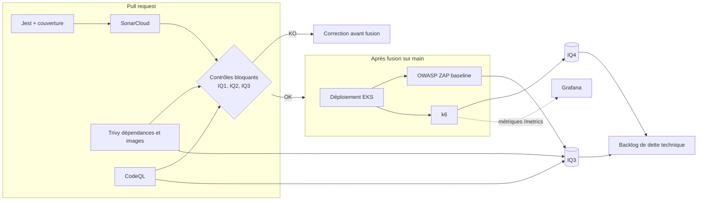

# Indicateurs qualité (ISO/IEC 25010) et dette technique

Carte S1-03. Critère visé : **C6** (au moins 4 indicateurs mesurés, axes d'amélioration sur la dette technique).

## 1. Principe

Quatre indicateurs, chacun rattaché à une caractéristique de la norme ISO/IEC 25010, mesuré automatiquement dans le pipeline (voir [ci-cd.md](ci-cd.md)) et assorti de deux seuils :

- **seuil cible** : la valeur qu'on vise, en dessous de laquelle on ouvre une action d'amélioration ;
- **seuil bloquant** : la valeur qui fait échouer le pipeline (ou, pour les indicateurs mesurés après déploiement, interdit de passer à l'étape suivante).

Un indicateur qui ne bloque rien et que personne ne relit n'évite pas la dette : c'est pourquoi chaque fiche précise l'action déclenchée par un dépassement.

| Réf. | Indicateur | Caractéristique ISO 25010 (sous-caractéristique) | Outil | Étape du pipeline |
|---|---|---|---|---|
| IQ1 | Couverture de tests de la logique métier | Maintenabilité (testabilité) | Jest, SonarCloud | PR |
| IQ2 | Dette technique et note de maintenabilité | Maintenabilité (modularité, analysabilité, modifiabilité) | SonarCloud | PR |
| IQ3 | Vulnérabilités critiques et hautes ouvertes | Sécurité (confidentialité, intégrité, responsabilité) | Trivy, Dependabot, CodeQL, OWASP ZAP | PR, `main`, hebdomadaire |
| IQ4 | Temps de réponse p95 et taux d'erreur sous charge | Efficacité de performance (comportement temporel, capacité) ; Fiabilité (disponibilité) | k6, Prometheus, Grafana | Après déploiement |

## 2. Fiches

### IQ1 : couverture de tests de la logique métier

| Rubrique | Contenu |
|---|---|
| Caractéristique visée | Maintenabilité, sous-caractéristique **testabilité** (un code couvert se modifie sans crainte de régression). |
| Définition mesurable | Pourcentage de lignes **et** de branches exécutées par les tests unitaires, sur le code de domaine : règles du contrôle automatique d'un article (photo, coordonnées dans la description, prix anormal) et appariement centres d'intérêt / article dans `notification-service`. Sont exclus de l'assiette les modules NestJS, DTO, fichiers de configuration et code généré. |
| Outil et emplacement | Jest (`--coverage`, rapport `lcov`) dans le job de tests de la PR ; import dans SonarCloud pour la quality gate. |
| Seuil cible | ≥ 85 % de couverture sur le code de domaine. |
| Seuil bloquant | < 80 % de couverture sur le **nouveau code** (condition de la quality gate SonarCloud) ; la PR n'est pas fusionnable. |
| Action en cas de dépassement | Sous la cible : une carte « tests manquants » est ajoutée au sprint en cours. Sous le seuil bloquant : écrire les tests avant la fusion, y compris les cas d'erreur des critères d'acceptation Gherkin ([user-stories.md](../backlog/user-stories.md)). |
| Limite connue | Une couverture élevée ne prouve pas la qualité des assertions. Elle est complétée par les tests d'acceptation (voir [politique-de-tests.md](politique-de-tests.md)) et par la revue de PR. |

### IQ2 : dette technique et note de maintenabilité

| Rubrique | Contenu |
|---|---|
| Caractéristique visée | Maintenabilité : **modularité**, **analysabilité**, **modifiabilité**. |
| Définition mesurable | Ratio de dette technique SonarCloud (temps estimé de correction des « code smells » rapporté au temps estimé de développement) et **note de maintenabilité** (A à E) ; complexité cognitive par fonction et taux de duplication du nouveau code en indicateurs de contexte. |
| Outil et emplacement | SonarCloud, quality gate évaluée sur chaque PR (analyse de `lint-test-build`, ajoutée en S2-08). |
| Seuil cible | Note **A** (ratio de dette ≤ 5 %) sur l'ensemble du code ; complexité cognitive ≤ 15 par fonction ; duplication ≤ 3 % du nouveau code. |
| Seuil bloquant | Note de maintenabilité inférieure à **A** sur le nouveau code, ou duplication > 3 % du nouveau code (conditions de la quality gate « Sonar way »). |
| Action en cas de dépassement | Refactorer avant fusion. Si la dette existante (hors nouveau code) passe sous la note A, ouvrir une carte de remboursement et y consacrer au minimum 10 % de la capacité du sprint suivant. |
| Limite connue | Les estimations de SonarCloud sont des ordres de grandeur ; l'indicateur sert à détecter une tendance, pas à chiffrer un coût exact. |

### IQ3 : vulnérabilités critiques et hautes ouvertes

| Rubrique | Contenu |
|---|---|
| Caractéristique visée | Sécurité : confidentialité, intégrité, responsabilité (traçabilité). |
| Définition mesurable | Nombre de vulnérabilités de sévérité **CRITICAL** ou **HIGH**, ouvertes, dont un correctif existe, dans trois périmètres : dépendances npm et images de conteneurs (Trivy, Dependabot), code source (CodeQL, SonarCloud) et application déployée (OWASP ZAP). |
| Outil et emplacement | Trivy sur les images à chaque PR (`--severity CRITICAL,HIGH --ignore-unfixed --exit-code 1`) ; CodeQL sur PR et une fois par semaine ; Dependabot hebdomadaire ; ZAP baseline après chaque déploiement sur `main`. Les résultats sont publiés au format SARIF dans l'onglet Security de GitHub. |
| Seuil cible | **0** vulnérabilité critique ou haute ouverte. |
| Seuil bloquant | **≥ 1** CRITICAL ou HIGH avec correctif disponible : la PR est bloquée (Trivy, CodeQL) ou le déploiement suivant est refusé (alerte ZAP de niveau élevé). |
| Action en cas de dépassement | Mettre à jour la dépendance ou l'image de base. Si aucun correctif n'existe, consigner une exception datée dans `.trivyignore` avec la justification, la mesure compensatoire et une date de réexamen ≤ 30 jours ; l'exception est reportée dans [le plan de remédiation](../remediation/README.md). |
| Limite connue | Une vulnérabilité sans correctif publié est exclue du seuil bloquant (`--ignore-unfixed`) mais reste suivie dans le registre d'exceptions. ZAP en mode baseline est passif : il ne remplace pas un test d'intrusion. |

### IQ4 : temps de réponse p95 et taux d'erreur sous charge

| Rubrique | Contenu |
|---|---|
| Caractéristique visée | Efficacité de performance (**comportement temporel**, **capacité**) et fiabilité (**disponibilité**). |
| Définition mesurable | Sous un profil de charge fixé, **p95 de la durée des requêtes HTTP** sur les parcours « consulter le catalogue » et « publier un article », et **taux de requêtes en erreur** (statut ≥ 500 ou échec réseau). |
| Outil et emplacement | k6 (scénario versionné dans `tests/load/`) lancé après le déploiement sur EKS, de façon optionnelle en CI (déclenchement manuel) et en démonstration. Les histogrammes de durée exposés sur `/metrics` (Prometheus) et affichés dans Grafana donnent la vue côté serveur ; les `thresholds` k6 donnent la vue côté client. |
| Seuil cible | p95 ≤ 300 ms et taux d'erreur < 0,1 % à la charge nominale. |
| Seuil bloquant | p95 > 800 ms **ou** taux d'erreur ≥ 1 % : échec du test k6, pas de promotion de la version. |
| Action en cas de dépassement | Lire les traces dans Grafana (CPU et mémoire des pods, latence par route, pool de connexions PostgreSQL), corriger, puis rejouer le même scénario. Une dégradation sans correction immédiate crée une carte de dette technique « performance ». |
| Hypothèse à calibrer | Les valeurs ci-dessus sont des hypothèses de départ. Le profil (nombre d'utilisateurs virtuels, durée, montée en charge) et les seuils seront fixés après une première mesure de référence sur 2 nœuds `t3.medium` et une base `db.t3.micro` (carte S4-01), puis figés dans le script k6. |

## 3. Comment le suivi évite l'accumulation de dette technique

La dette technique se forme quand un écart de qualité est accepté « pour l'instant » sans être tracé ni remboursé. Chaque indicateur agit à un endroit précis de ce mécanisme.

| Indicateur | Forme de dette évitée | Mécanisme |
|---|---|---|
| IQ1 | Dette de tests : code que personne n'ose modifier. | La quality gate s'applique au **nouveau code** : on ne peut pas ajouter de logique métier non testée, même si l'historique est faible. Les règles du contrôle automatique sont les plus susceptibles d'évoluer (nouveaux motifs de refus, enchères), donc les plus coûteuses à laisser sans filet. |
| IQ2 | Dette de conception et de lisibilité : fonctions complexes, duplication. | Le seuil sur le nouveau code stoppe l'accumulation ; le suivi du ratio global détecte la dérive de l'existant. Le remboursement est planifié (10 % de la capacité) au lieu d'être renvoyé à plus tard. |
| IQ3 | Dette de sécurité : dépendances obsolètes, images périmées. | Dependabot et Trivy transforment la mise à jour en petits changements réguliers plutôt qu'en migration lourde. Le registre d'exceptions datées empêche qu'un risque accepté devienne un risque oublié. |
| IQ4 | Dette de performance et de capacité : dégradation progressive, découverte tardive. | Le même scénario k6 est rejoué à chaque jalon ; la comparaison avec la mesure de référence révèle une régression avant qu'un utilisateur la subisse. |

Trois règles de gouvernance complètent le dispositif :

1. **Aucune exception silencieuse.** Un seuil bloquant ne se contourne que par une exception écrite (qui, pourquoi, mesure compensatoire, date de réexamen).
2. **Revue à chaque fin de sprint.** Les quatre valeurs sont relevées dans le tableau ci-dessous ; une tendance qui se dégrade sur deux sprints déclenche une action, même si les seuils ne sont pas franchis.
3. **La dette est visible dans le backlog.** Les écarts à la cible deviennent des cartes étiquetées `dette-technique`, avec une estimation, au même titre qu'une fonctionnalité.

## 4. Relevés

À remplir à chaque fin de sprint à partir des rapports de la CI. Aucune mesure n'existe à ce jour : le code applicatif sera ajouté en S2-07 et l'analyse SonarCloud en S2-08.

| Date | Sprint | IQ1 couverture domaine | IQ2 note / ratio de dette | IQ3 vulnérabilités C+H ouvertes | IQ4 p95 / erreurs | Commentaire |
|---|---|---|---|---|---|---|
| | | | | | | |
