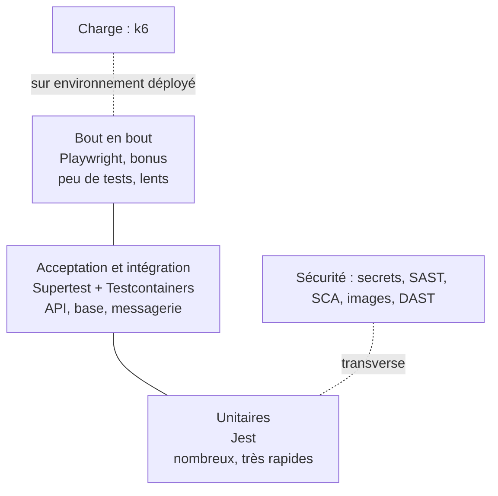

# Politique de tests

Carte S1-06. Critère visé : **C7** (processus formalisé : types, outils, parties prenantes ; au moins 2 types appliqués au POC et qui passent).

La politique s'appuie sur le [pipeline CI/CD](ci-cd.md) pour l'exécution, sur les [indicateurs qualité](indicateurs-qualite.md) pour les seuils, et sur les [user stories](../backlog/user-stories.md) pour les critères d'acceptation.

## 1. Principes

1. **Pyramide des tests** : beaucoup de tests unitaires rapides, moins de tests d'intégration, peu de tests de bout en bout.
2. **Un critère d'acceptation = au moins un test automatisé.** Chaque scénario Gherkin de la backlog est traçable jusqu'à un test.
3. **Les tests tournent dans la CI**, pas seulement en local ; une fusion n'est possible que si ils passent.
4. **Tests isolés et reproductibles** : PostgreSQL et RabbitMQ sont lancés à la demande par Testcontainers, sans dépendance à un environnement partagé.
5. **Cas d'erreur d'abord pour la sécurité** : chaque règle d'autorisation est testée dans les deux sens (accès autorisé, accès refusé en 401 ou 403).

## 2. Types de tests

| Type | Objectif | Outil | Périmètre | Seuil | Moment dans le pipeline | Responsable |
|---|---|---|---|---|---|---|
| **Unitaire** | Vérifier une règle isolée, sans réseau ni base | Jest | Règles du contrôle automatique (photo, e-mail ou téléphone dans la description, prix anormal), appariement des centres d'intérêt, mapping des événements | Couverture du code de domaine ≥ 85 % (cible), ≥ 80 % sur le nouveau code (bloquant), voir IQ1 | PR, étape « Tests unitaires » | Développeur auteur du code ; relecture par le lead dev |
| **Intégration** | Vérifier les interactions réelles entre un service et ses dépendances | Jest, Supertest, Testcontainers (PostgreSQL, RabbitMQ) | Persistance de `catalog-service` (articles, motifs de refus), publication de `article.publie` sur l'exchange `collector.events`, consommation et idempotence dans `notification-service` | 100 % des tests passent ; aucun test ignoré sans justification | PR, étape « Tests d'intégration » | Développeur ; lead dev pour le contrat d'événements |
| **Acceptation** | Prouver qu'une user story répond au besoin, scénario par scénario | Jest + Supertest sur l'API, écrits à partir des scénarios Gherkin | Les 8 stories du POC : connexion vendeur, publication, acceptation, refus avec motif, catalogue public, centres d'intérêt, notification, 401 / 403 | Chaque scénario Gherkin de priorité *Must* est couvert et passe | PR, avec les tests d'intégration | Lead dev (rédaction avec le PO), développeur (implémentation) |
| **Non-régression** | S'assurer qu'une modification ne casse pas l'existant | Toute la suite unitaire + intégration + acceptation rejouée ; test de contrat sur `packages/contracts` (compilation TypeScript du producteur et du consommateur contre les mêmes types) | Tout le monorepo | 0 échec ; tout bug corrigé est accompagné d'un test qui le reproduit | Chaque PR et chaque fusion sur `main` | Développeur auteur de la correction |
| **Charge** | Mesurer le temps de réponse et le taux d'erreur, démontrer la montée en charge | k6 | Parcours « consulter le catalogue » (lecture) et « publier un article » (écriture) sur EKS | p95 ≤ 300 ms et erreurs < 0,1 % (cible) ; p95 > 800 ms ou erreurs ≥ 1 % (bloquant), voir IQ4 | Après déploiement, manuel en CI et en démonstration | Lead dev ; SRE à terme |
| **Sécurité : secrets** | Empêcher la fuite de secrets | gitleaks | Historique complet du dépôt | 0 secret détecté | PR et `main` | Chaque contributeur ; lead dev pour les exceptions |
| **Sécurité : SAST** | Détecter les failles dans le code écrit | SonarCloud, CodeQL | Code TypeScript des services et du front | 0 alerte haute ou critique non justifiée ; points sensibles revus à 100 % | PR et hebdomadaire | Développeur ; lead dev arbitre |
| **Sécurité : SCA et images** | Détecter les dépendances et images vulnérables | Dependabot, `npm audit`, Trivy | Dépendances npm, images Docker, configuration Terraform et Helm | 0 CRITICAL / HIGH corrigeable (IQ3) | PR, `main`, hebdomadaire | Développeur ; lead dev pour les exceptions datées |
| **Sécurité : DAST** | Détecter les failles de l'application déployée | OWASP ZAP (baseline) | URL publique de l'environnement EKS | 0 alerte de niveau élevé non justifiée | Après chaque déploiement sur `main` | Lead dev ; QA / SRE à terme |
| **Bout en bout** *(bonus)* | Valider un parcours complet depuis le navigateur | Playwright | Connexion vendeur, publication, notification reçue côté acheteur ; vérifications d'accessibilité automatisables (axe) | Parcours nominal vert ; non bloquant tant qu'il n'est pas stabilisé | Après déploiement, manuel au départ | QA automaticien (recrutement), lead dev en attendant |

## 3. Traçabilité entre stories et tests

Convention : le nom du fichier de test reprend l'identifiant de la story, et chaque `describe` reprend le titre du scénario Gherkin. Ainsi `us-04-controle-refuse.acceptance.spec.ts` couvre tous les scénarios de la story US-04.

| Story ([user-stories.md](../backlog/user-stories.md)) | Test d'acceptation | Tests unitaires associés |
|---|---|---|
| US-01 Connexion vendeur | Appel de l'API avec un jeton Keycloak valide / absent / expiré | Gardes d'authentification et de rôle |
| US-02 Publier un article | Création d'un article, validation des champs obligatoires | Validation des DTO |
| US-03 Contrôle accepte | Article valide → statut publié + événement `article.publie` | Règles d'acceptation |
| US-04 Contrôle refuse | Un cas par motif de refus (photo, coordonnées, prix) + événement `article.refuse` | Détection e-mail et téléphone, borne de prix |
| US-05 Catalogue sans compte | Lecture sans jeton, seuls les articles publiés sont visibles | Filtres de liste |
| US-06 Centres d'intérêt | Enregistrement et relecture des centres d'intérêt de l'acheteur | Validation des catégories |
| US-07 Notification | Événement publié → notification créée pour les acheteurs correspondants uniquement, sans doublon à la relivraison | Appariement, idempotence par `eventId` |
| US-08 401 / 403 | Matrice rôle × endpoint | Gardes de rôle |

## 4. Parties prenantes

| Partie prenante | Statut dans le POC | Rôle dans la politique de tests |
|---|---|---|
| **Développeurs** (2 confirmés) | Équipe cible ; le POC est réalisé par le lead dev seul | Écrivent les tests unitaires, d'intégration et d'acceptation de leur code ; corrigent les échecs ; ajoutent un test de non-régression à chaque bug |
| **Lead dev** | Rôle tenu par l'étudiant | Définit la politique, relit les tests et les contrats d'événements, arbitre les exceptions de sécurité, maintient les seuils, lance les tests de charge |
| **QA automaticien** | Recrutement envisagé, **absent du POC** : le lead dev tient le rôle | Industrialise les tests de bout en bout (Playwright), maintient les jeux de données, challenge les critères d'acceptation avec le PO, suit la stabilité (tests instables) |
| **DevOps / SRE** | Recrutement envisagé, **absent du POC** | Maintient l'environnement de test (EKS, pipeline), fiabilise les tests de charge et d'observabilité |
| **PO ou direction** | Rôle joué par le cahier des charges et l'utilisateur | Valide les scénarios Gherkin avant développement et prononce la recette en fin de sprint à partir des rapports d'acceptation |

Répartition des responsabilités (R : réalise, A : approuve, C : consulté, I : informé) :

| Activité | Développeur | Lead dev | QA | SRE | PO / direction |
|---|---|---|---|---|---|
| Rédiger les scénarios Gherkin | C | R | C | | A |
| Écrire les tests unitaires et d'intégration | R | A | C | | |
| Écrire les tests d'acceptation | R | A | C | | I |
| Maintenir la suite de bout en bout | C | A | R | | |
| Définir et exécuter les tests de charge | C | A | C | R | I |
| Traiter les alertes de sécurité | R | A | | C | I |
| Prononcer la recette | I | R | C | | A |

## 5. Environnements et données de test

| Niveau de test | Environnement | Données |
|---|---|---|
| Unitaire | Poste de développement et runner CI, sans service externe | Valeurs construites dans le test |
| Intégration et acceptation | Runner CI avec Docker : conteneurs PostgreSQL et RabbitMQ créés puis détruits par Testcontainers ; Keycloak remplacé par des jetons signés avec une clé de test, ou conteneur Keycloak pour les scénarios de rôles | Fabriques de données dans le code, base vierge à chaque suite |
| Smoke, DAST, charge | Environnement EKS du Learner Lab, créé à la session | Données de démonstration injectées par script, jamais de données réelles |

## 6. Règles de gestion

- **Tests instables** : un test qui échoue de façon intermittente est mis en quarantaine avec une carte `dette-technique` dans la semaine ; il ne reste pas désactivé sans suivi.
- **Aucun `skip` sans carte associée** dans le code fusionné.
- **Bug corrigé = test ajouté** qui échoue avant la correction et passe après.
- **Revue** : un changement de règle du contrôle automatique n'est fusionné qu'avec le scénario Gherkin correspondant mis à jour.

## 7. Sorties attendues

| Sortie | Format | Produite par | Conservée où | Destinataire |
|---|---|---|---|---|
| Rapport de tests unitaires et d'intégration | JUnit XML, console | Jest | Artefact de la CI | Développeurs |
| Couverture | `lcov` et rapport HTML | Jest | Artefact de la CI, SonarCloud | Lead dev (IQ1) |
| Quality gate et dette technique | Tableau de bord SonarCloud | SonarCloud | SonarCloud | Lead dev (IQ1, IQ2) |
| Rapport de vulnérabilités | SARIF | Trivy, CodeQL | Onglet Security de GitHub | Lead dev (IQ3) |
| Rapport DAST | HTML et JSON | OWASP ZAP | Artefact de la CI | Lead dev, base du plan de remédiation |
| Résultats de charge | Résumé JSON k6, captures Grafana | k6, Grafana | Artefact de la CI, dossier de démonstration | Lead dev, jury (IQ4) |
| Rapport de recette | Tableau scénario → résultat → date | Lead dev à partir de l'exécution des tests d'acceptation | `docs/` à chaque fin de sprint | PO / direction |

## 8. Preuves pour le POC (critère C7)

Au minimum **deux types de tests appliqués au POC et qui passent** : unitaires et intégration / acceptation dès le sprint 3, complétés par les tests de sécurité automatiques (gitleaks, Trivy, SonarCloud) et par le test de charge k6 en démonstration. À ce jour, aucun test applicatif n'existe : le code des services est ajouté en S2-07 ; cette politique est le référentiel contre lequel il sera écrit.
